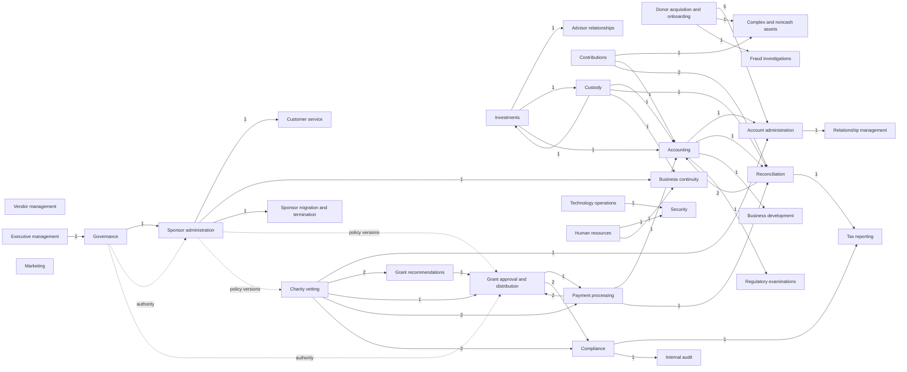

# 03 — Enterprise work inventory (Phase Two)

> Generated by `tools/fs/Unbound.ReqAudit` (`assemble-simplification`) from `data/`. Do not edit by hand.

This inventory covers the work a DAF organization performs, independent of current requirements. It comprises 143 activities across 31 functions (`data/work-inventory.jsonl`).

## Scope, method and evidence status (ORG group)

*Source pass: Work inventory, operating model and staffing.*

**Phases owned:** Two (enterprise work inventory), Three (minimum-touch organization, human-intervention taxonomy, assignment models, charity-vetting operating design), Six (organizational structure and staffing). DOM code **ORG**.

**Method.** 143 activities (SPW-001..SPW-143) were enumerated across 31 business functions from the requirement corpus (each activity cites existing requirement IDs; evidence column gives `unbound:<path>:<line>` from `requirements/reconciliation/2026-11-23/data/inventory.csv` or the gap/refinement JSONL). For each activity two human-minute figures are recorded per driver unit: *conventional* and *minimum-touch*. **All minutes and volumes are assumptions [A]**; no operational measurement exists (economic-model.md:3). Volumes at 100k accounts reuse the baseline's grants (8/account) and contributions (2/account) (daf-landscape:research/ai-native-daf-enterprise/09-financial-models/financial-and-staffing-models.md:18-21 @6b3083a, where they are themselves partly [A]). Aggregates were **executed** by a Python script over the JSONL (output reported below); they are **[D]** (derived arithmetic from [A] inputs), not measurements.

**Independence caveat.** All perspectives here come from one model in one session. Agreement between this analysis and earlier same-model passes (theoretical-validation, discovery) is **not** independent validation.

**Output files:** work-inventory.jsonl (143), roles.jsonl (24), findings.jsonl (13), requirements.jsonl (2), refinements.jsonl (3), scenarios.jsonl (7), decisions.jsonl (6), rejected.jsonl (7).

## Enterprise work inventory summary

*Source pass: Work inventory, operating model and staffing.*

**What was inventoried.** 143 recurring or event-driven activities in 31 functions, each with trigger, purpose, decision, beneficiary, consequence of omission, elimination/prevention/consolidation options, automation class, human-required conditions, frequency driver, minutes, existing requirement IDs, duplication and dependencies.

**Automation class (minimum-touch target):** deterministic 57, mixed 63, human 19, ai-assisted 4. AI-assisted is deliberately rare: AI is used where evidence is unstructured (answers grounded in an approved corpus, regulatory-change reading); everything rule-expressible is deterministic first (mission principle; organization §3, unbound:research/daf-theoretical-enterprise-validation/03-organization/organization-and-authority.md:48-60).

**Executed aggregate (Python over work-inventory.jsonl) — direct activity time only:**

| Accounts | Conventional direct h | Min-touch direct h | Conventional direct FTE (H=1,600) | Min-touch direct FTE |
|---|---|---|---|---|
| 1,000 | 16,767 | 3,666 | 10.5 | 2.3 |
| 10,000 | 50,958 | 8,774 | 31.8 | 5.5 |
| 100,000 | 379,240 | 55,220 | 237.0 | 34.5 |
| 1,000,000 | 3,634,868 | 510,435 | 2,271.8 | 319.0 |
| 5,000,000 | 18,082,635 | 2,526,236 | 11,301.6 | 1,578.9 |

Direct time excludes supervision, training, utilisation loss and engineering. The conventional derived figure at 100k (237.0 direct FTE) is well below the Vanguard-ratio comparator of 431 employees at 100k [S, daf-landscape:research/ai-native-daf-enterprise/09-financial-models/financial-and-staffing-models.md:25,37 @6b3083a], so the inventory **undercounts conventional work** (no management layers, rework, sales, IT build). It is used only to compare the two columns on identical scope, not to claim a conventional headcount.

**By function at 100k accounts (sorted by conventional hours):**

| Function | Activities | Conventional h/yr @100k [D] | Minimum-touch h/yr @100k [D] | Reduction |
|---|---|---|---|---|
| Grant approval and distribution | 7 | 106,433 | 13,033 | 88% |
| Grant recommendations | 6 | 57,667 | 1,675 | 97% |
| Charity vetting | 10 | 46,300 | 7,350 | 84% |
| Contributions | 7 | 28,083 | 1,175 | 96% |
| Complex and noncash assets | 6 | 27,000 | 11,565 | 57% |
| Donor acquisition and onboarding | 6 | 21,500 | 1,300 | 94% |
| Account administration | 8 | 19,667 | 2,567 | 87% |
| Payment processing | 9 | 14,642 | 2,779 | 81% |
| Customer service | 5 | 11,275 | 2,263 | 80% |
| Compliance | 7 | 8,317 | 1,393 | 83% |
| Advisor relationships | 4 | 6,397 | 1,239 | 81% |
| Investments | 7 | 6,118 | 321 | 95% |
| Reconciliation | 4 | 4,978 | 931 | 81% |
| Relationship management | 2 | 4,750 | 2,167 | 54% |
| Fraud investigations | 3 | 3,120 | 1,724 | 45% |
| Accounting | 6 | 2,628 | 332 | 87% |
| Custody | 4 | 1,760 | 172 | 90% |
| Business development | 2 | 1,696 | 804 | 53% |
| Sponsor migration and termination | 4 | 1,160 | 234 | 80% |
| Technology operations | 5 | 938 | 533 | 43% |
| Marketing | 2 | 730 | 240 | 67% |
| Security | 3 | 672 | 276 | 59% |
| Sponsor administration | 4 | 620 | 201 | 68% |
| Vendor management | 3 | 544 | 199 | 63% |
| Human resources | 3 | 516 | 213 | 59% |
| Regulatory examinations | 2 | 400 | 100 | 75% |
| Executive management | 3 | 384 | 120 | 69% |
| Governance | 3 | 264 | 112 | 58% |
| Tax reporting | 3 | 250 | 55 | 78% |
| Internal audit | 2 | 240 | 100 | 58% |
| Business continuity | 3 | 192 | 46 | 76% |

**Reading the numbers.**
- Five functions carry most minimum-touch hours: grant approval/distribution (exception decisions SPW-060), complex assets (SPW-026, SPW-030), charity vetting (ED/ER SPW-053/054), payment exceptions, and service. All five are **exception-driven**; their human minutes scale with volume × exception share.
- Functions that are almost entirely eliminated as human work: grant recommendations, contributions, investments, accounting postings, statements, acknowledgments — deterministic once inputs are authoritative.
- 3 activities exist **only** in the minimum-touch model (SPW-088, SPW-116, SPW-125): independent sampling of straight-through decisions, AI configuration and model-risk review, cost initiatives. They add ≈720 h/yr regardless of scale [D] (SPF-ORG-009). Omitting them would overstate savings.
- Moving work to donors, charities or vendors is not counted as elimination: self-service items (e.g. SPW-007, SPW-014) keep a residual minute figure, and outsourced work (liquidation agents, CPA, counsel) is costed as purchased services in the staffing model.

**Elimination vs prevention vs automation.** `can_eliminate` = Y for 15 activities (timers, generated registers, automatic remittance, flag expiry), partial for 65, N for 63 (legally required, independent control or reserved judgment — these are simplified or automated, not removed).

## Dependency graph

*Source pass: Work inventory, operating model and staffing.*

Solid edges are activity-level `depends_on` links aggregated to functions (edge label = number of activity links), computed from work-inventory.jsonl. Dotted edges are authority/policy dependencies that every decision carries implicitly (DoA and policy version are evaluated on every command, unbound:research/daf-theoretical-enterprise-validation/03-organization/organization-and-authority.md:106-113).

**Critical paths (activity level; a delay or failure anywhere stops the outcome):**

| Outcome | Path | Human-required nodes in minimum-touch | Single points of failure |
|---|---|---|---|
| Routine grant paid | SPW-043 → SPW-047 → SPW-049/050 → SPW-059 → SPW-062 → SPW-066 → SPW-068 → SPW-081 → SPW-075 → SPW-077 → SPW-013 | none when all gates pass; SPW-077 certification monthly | charity status source freshness (SPW-050/051); payment gate; bank file ingestion (SPW-081) |
| Exception grant paid | … SPW-059 → SPW-060 (A4) → [SPW-053/054 if foreign/ER] → SPW-068 … | SPW-060, SPW-053/054 | eligible decider availability (UNB-SMP-ORG-002); December surge |
| Contribution credited and acknowledged | SPW-019/021 → SPW-022 → SPW-075 → SPW-081/083 → SPW-077 | none for routine | processor/bank files; acknowledgment template gate |
| Complex gift to grantable value | SPW-002 → SPW-026 → SPW-029 → SPW-030 → SPW-021 → SPW-022/027/028 | SPW-026, SPW-029 (acceptance authority) | gift-acceptance authority capacity |
| Payee change to safe payment | SPW-067 → SPW-066 (cooling-off) → SPW-068 → SPW-070 on return | SPW-067 when risk signals | payee approver ≠ releaser |
| Period close | SPW-040, SPW-081, SPW-082, SPW-083 → SPW-075 → SPW-077 → SPW-013 → SPW-084 → SPW-095 | SPW-077 certification, SPW-082 unexplained breaks | independent reconciler (TVR-ORG-003) |
| Sponsor launch | SPW-140 → SPW-106 → SPW-108 → SPW-105 → SPW-121 (board) | all (one-time) | board delegation resolution (UNB-RCN-WF-016) |

**Structural observations.** (1) Charity vetting and payments are upstream of grant approval; their freshness, not human review, gates throughput. (2) Reconciliation feeds accounting and tax; it is the main enterprise-level control path and must sit outside the payment chain. (3) Governance → sponsor administration → every decision is the authority spine: a lapsed delegation suspends routine approval platform-wide (UNB-RCN-WF-016), so DoA maintenance (SPW-108) is on every critical path even though it is rare.

## Duplicated work across departments, systems and organizations

*Source pass: Work inventory, operating model and staffing.*

Every row is drawn from the `duplicated_across` field of work-inventory.jsonl. "Legal/contractual limit" states what may NOT be consolidated.

| Duplicated work | Where it is duplicated | SPW | Consolidation | Legal/contractual limit | Type |
|---|---|---|---|---|---|
| Charity status and identity lookup per grant and per sponsor | Grants staff each grant; every sponsor for the same charity | SPW-049, 050, 051, 052, 055, 057 | Shared factual claims, verified once, monitored continuously; per-sponsor reliance snapshot written automatically | Sponsor-specific eligibility/purpose decisions are not shared (UNB-CHAR-018, UNB-CHAR-036/037; RR-REQ-X-007-r1 per-sponsor snapshot); cross-sponsor reliance needs counsel (REQ-X-007) | Organizations |
| Equivalency determinations for the same foreign grantee | Each sponsor commissions its own ED | SPW-053 | Reuse ED advice within its ~2-year currency (grt.md:209) and route via US intermediaries (UNB-XIN-NPG-002) | Reliance on another sponsor's ED advice is unverified — counsel; practitioner engagement terms may restrict sharing | Organizations |
| Payee bank-account verification | Each sponsor verifies the same charity's account; AP vs grants inside one sponsor | SPW-066, 067 | One DestinationEvidence record per destination; reuse until change or risk signal (CA-180 #7) | Grant payee profiles separate from operating-vendor payees (UNB-XIN-ERP-004); bank detail sharing across sponsors is a data-sharing question (UNB-KNOW-012) | Departments + organizations |
| Donor identity verification and sanctions screening | Sponsor, custodian, partner, bank | SPW-003, 004, 085 | Accept federated assurance where contract allows; screen once per subject-event; keep sponsor's own result | Each regulated party keeps its own screening obligation; sponsor cannot rely on bank screening for its strict liability (REG-036) | Organizations |
| Reconciliation of the same cash/positions | Custodian, fund administrator, sponsor GL, auditor | SPW-040, 081, 082 | One continuous three-way reconciliation; auditor reads evidence | Independence of reconciler (TVR-ORG-003); auditor must re-perform samples | Departments + systems |
| Re-keying of intake data | CRM, fund admin, custody opening, paper forms | SPW-002, 007, 043 | Single intake, typed commands, contracts generated once (REQ-X-057 one system) | None | Systems |
| Program terms and answer scripts | Marketing, service scripts, partner collateral, AI prompts | SPW-001, 098, 101, 107, 128 | One ProgramDescription (UNB-XIN-OTH-001) and one Answer Corpus (UNB-XIN-SVC-007); Brand Kit protected terms (UNB-RCN-PLT-007) | Partner co-branding may require partner approval | Departments |
| Vendor SOC report review | Each sponsor reviews the same subservice organizations; compliance + IA + SOC auditor test same controls | SPW-087, 109, 133, 136 | Operator publishes a complementary-user-control map once (REQ-X-073); combined testing calendar | Each sponsor remains responsible for its own vendor risk acceptance | Organizations + departments |
| NAV / fee calculations | Custodian NAV vs sponsor NAV vs fund admin; advisor-firm billing vs sponsor fee engine | SPW-017, 033, 076 | Single fee engine computing daily; external values are inputs with reconciliation | Book-of-record designation per function (UNB-XIN-ACC-010) | Systems + organizations |
| Status inquiries answered by multiple desks | Service, grants, advisor desk | SPW-018, 098 | Proactive five-dimension status; one Contact record (UNB-XIN-SVC-001) | None | Departments |
| Dormancy and succession tracking | Service, compliance, legal each review documents | SPW-006, 009, 010 | One case with CradleToGrave owner; pre-verified successors | Document evaluation stays human (legal) | Departments |
| Policy watch and regulatory change | Each sponsor watches separately | SPW-086 | Operator-level watch list with sponsor-level adoption (UNB-RCN-REG-001) | Adoption decision is the sponsor's | Organizations |

**Net effect.** Most duplication is **across organizations** (sponsors, custodians, banks, partners) rather than inside one sponsor. Inside one sponsor, a one-system design (REQ-X-057) removes most departmental duplication. Across organizations, only **factual evidence** can be shared; **decisions and legal reliance** remain per sponsor. That limit caps the savings from a shared registry at the factual-verification portion of vetting (see charity vetting operating design).

## Activities by function and automation class

| Function | deterministic | ai-assisted | mixed | human | Activities |
|---|---|---|---|---|---|
| Account administration | 4 | 0 | 4 | 0 | 8 |
| Accounting | 3 | 0 | 3 | 0 | 6 |
| Advisor relationships | 1 | 1 | 2 | 0 | 4 |
| Business continuity | 1 | 0 | 1 | 1 | 3 |
| Business development | 1 | 0 | 0 | 1 | 2 |
| Charity vetting | 3 | 0 | 5 | 2 | 10 |
| Complex and noncash assets | 2 | 0 | 3 | 1 | 6 |
| Compliance | 1 | 1 | 3 | 2 | 7 |
| Contributions | 5 | 0 | 2 | 0 | 7 |
| Custody | 2 | 0 | 2 | 0 | 4 |
| Customer service | 1 | 1 | 1 | 2 | 5 |
| Donor acquisition and onboarding | 5 | 1 | 0 | 0 | 6 |
| Executive management | 0 | 0 | 3 | 0 | 3 |
| Fraud investigations | 0 | 0 | 2 | 1 | 3 |
| Governance | 0 | 0 | 2 | 1 | 3 |
| Grant approval and distribution | 3 | 0 | 1 | 3 | 7 |
| Grant recommendations | 6 | 0 | 0 | 0 | 6 |
| Human resources | 1 | 0 | 1 | 1 | 3 |
| Internal audit | 0 | 0 | 1 | 1 | 2 |
| Investments | 4 | 0 | 3 | 0 | 7 |
| Marketing | 1 | 0 | 1 | 0 | 2 |
| Payment processing | 5 | 0 | 4 | 0 | 9 |
| Reconciliation | 3 | 0 | 1 | 0 | 4 |
| Regulatory examinations | 0 | 0 | 1 | 1 | 2 |
| Relationship management | 0 | 0 | 2 | 0 | 2 |
| Security | 0 | 0 | 2 | 1 | 3 |
| Sponsor administration | 0 | 0 | 4 | 0 | 4 |
| Sponsor migration and termination | 1 | 0 | 3 | 0 | 4 |
| Tax reporting | 0 | 0 | 2 | 1 | 3 |
| Technology operations | 3 | 0 | 2 | 0 | 5 |
| Vendor management | 1 | 0 | 2 | 0 | 3 |

## Activity inventory

| ID | Function | Activity | Trigger | Why it exists | If not performed | Eliminate? | Prevent? | Automation | Human when | Min conv. [A] | Min min-touch [A] | Existing IDs |
|---|---|---|---|---|---|---|---|---|---|---|---|---|
| SPW-001 | Donor acquisition and onboarding | Answer prospect questions about the program, fees and DAF rules | Prospect contact or web visit | Donors need accurate program terms before contracting | Mis-sold programs, complaints | partial — published ProgramDescription and grounded answers remove most staff explanation | Generate ProgramDescription from active config (UNB-XIN-OTH-001) | ai-assisted | Customer requests a person; question outside corpus | 15 | 1.0 | UNB-XIN-SVC-007, UNB-XIN-OTH-001 |
| SPW-002 | Donor acquisition and onboarding | Fund establishment intake and fund agreement execution | Donor submits establishment request | Creates the legal fund relationship and advisory privileges | No legal basis for advisory privileges | partial — standard agreement with e-signature; no human for standard terms | Single progressive intake; reject free-text term edits | deterministic | Nonstandard terms, entity donor, account-type classification unclear | 30 | 2.0 | ADM-002, UNB-RCN-ENT-011 |
| SPW-003 | Donor acquisition and onboarding | Verify identity of donor and advisor principals | New principal created | Prevent impersonation and account takeover | Fraudulent accounts; grants misdirected | N — but performed once per principal and reused across funds | Federated assurance reuse with sponsor-direct authenticator | deterministic | Evidence mismatch or fraud indicators | 10 | 0.5 | REQ-X-072, UNB-XIN-IAM-001, UNB-RCN-ENT-014 |
| SPW-004 | Donor acquisition and onboarding | Screen new donors/advisors against sanctions lists | New principal or list update | Strict-liability sanctions exposure (REG-036) | Prohibited dealings | N | Fuzzy-match tuning reduces false positives | deterministic | Potential match (true-match disposition is reserved) | 3 | 0.2 | UNB-RCN-GRT-007, CTL-013, UNB-RCN-ENT-014 |
| SPW-005 | Donor acquisition and onboarding | Activate fund and send welcome and access | Agreement executed and identity verified | Fund can receive contributions | Donor cannot contribute | Y — collapse into SPW-002 completion event | n/a | deterministic | Never | 5 | 0.0 | ADM-002, UNB-RCN-PLT-002 |
| SPW-006 | Donor acquisition and onboarding | Record successor and charitable-default designations at setup | Fund establishment | Avoid later succession disputes and dormancy | Costly succession cases later | N — but can be pre-verified (alternatives §5C) | Annual re-confirmation prompt | deterministic | Conflicting or incomplete designation | 8 | 0.5 | REQ-X-068, UNB-GAP-015 |
| SPW-007 | Account administration | Process profile and contact updates | Donor or advisor change request | Keep notices and authority channels current | Notices to wrong address; takeover risk | N — self-service with step-up removes staff | Self-service with step-up | deterministic | Sensitive change with risk flag | 6 | 0.3 | ADM-017, REQ-X-072 |
| SPW-008 | Account administration | Add/remove advisors, representatives and viewers | Donor request or invitation | Advisory privilege is a legal relationship | Unauthorized recommendations | partial — invitation flow; human only for representative evidence (POA, guardian) | Typed invitations with expiry (UNB-RCN-WF-019) | mixed | Representative documents (POA, guardianship) need evaluation | 20 | 1.0 | ADM-005, UNB-PART-007, UNB-XIN-CLM-006, UNB-RCN-WF-019 |
| SPW-009 | Account administration | Handle donor death, incapacity and succession | Death/incapacity report | Authority transitions are legal events | Wrong person directs charitable assets | N | Pre-verified successors (alternatives §5C) | mixed | Always for document evaluation; disputes | 180 | 60.0 | UNB-WF-013, REQ-X-008, UNB-RCN-ENT-004, UNB-SUCC-007 |
| SPW-010 | Account administration | Dormant account outreach and charitable default | Inactivity threshold | Prevent indefinite inactive funds; policy compliance | Funds stagnate; policy breach | partial — automated outreach; human only for default execution approval | Successor pre-verification | deterministic | Executing charitable default; contested outreach | 30 | 2.0 | UNB-WF-015, UNB-RCN-ENT-005, UNB-RCN-WF-030 |
| SPW-011 | Account administration | Fund closure, split and merge | Donor request, policy or succession | Lifecycle completeness | Orphaned balances | partial — state machine automates steps | n/a | mixed | Residual disposition approval; contested splits | 90 | 15.0 | UNB-RCN-ENT-006, UNB-RCN-ENT-008, UNB-ACC-011 |
| SPW-012 | Account administration | Sponsor-to-sponsor fund transfers (in/out) | Donor request | Donor portability; DAF-to-DAF is a grant | Assets trapped | N | Counsel-approved inbound classification rule | mixed | First transfer to an unknown sponsor | 120 | 20.0 | UNB-RCN-ENT-007, UNB-XIN-EVA-009 |
| SPW-013 | Account administration | Generate and distribute fund statements | Statement period end | Donor information; record of fund activity | Donor uncertainty; contacts | partial — exception-driven publication; zero human review when gates pass | Publish only from sealed snapshot | deterministic | Gate failure (unreconciled fund) | 0.3 | 0.005 | REQ-X-032, REQ-X-040, UNB-XIN-EVA-003 |
| SPW-014 | Account administration | Account recovery and credential reset | Locked-out user | Restore access without enabling takeover | Locked-out donors call repeatedly | partial — self-service recovery | Passkeys; sponsor-direct authenticator | deterministic | Recovery evidence conflicting; takeover indicators | 12 | 1.0 | REQ-X-072, UNB-XIN-IAM-001 |
| SPW-015 | Advisor relationships | Onboard advisor firms and integrations | Firm agreement | Advisors distribute and manage DAF assets | Unauthorized advisors | N | Standard firm agreement | mixed | Contract terms; firm authority evidence | 600 | 120.0 | UNB-WF-012, REQ-X-062 |
| SPW-016 | Advisor relationships | Classify advisor relationships and set up advisor-managed account mandates | Advisor-managed account request | Fees to advisors from fund assets may be prohibited benefits | Excise-tax exposure (§4967/§4958) | N | Counsel-approved classification rule | mixed | Relationship not covered by rule | 45 | 10.0 | UNB-XIN-INV-001, UNB-RCN-FIN-010, UNB-RCN-ENT-015 |
| SPW-017 | Advisor relationships | Compute and pay advisor fees | Billing period | Contractual compensation | Mis-billing | partial — daily computed fees remove manual billing | FeeBase contracts | deterministic | Disputed invoice | 2400 | 30.0 | UNB-XIN-ERP-001, UNB-XIN-ERP-002, UNB-RCN-FIN-005 |
| SPW-018 | Advisor relationships | Answer advisor service requests | Advisor contact | Advisors act for many donors | Advisor churn | partial — portal and API self-service | Proactive status to advisors | ai-assisted | Advisor requests person; account-specific dispute | 10 | 2.0 | UNB-XIN-SVC-001, REQ-X-062 |
| SPW-019 | Contributions | Receive and match cash, ACH and card contributions | Funds arrive | Credit the right fund at the right time | Funds unattributed; acknowledgment wrong | N — but matching is deterministic | Intent-first contribution with reference | deterministic | Unmatched receipt after deterministic rules | 4 | 0.1 | UNB-ACC-006, UNB-XIN-BNK-008, REQ-X-009 |
| SPW-020 | Contributions | Process paper checks and unidentified receipts | Check received at lockbox | Some donors still mail checks | Lost gifts | partial — steer donors to electronic rails; lockbox OCR | Pre-printed fund reference coupons | mixed | No remittance match | 6 | 1.0 | UNB-REM-003, UNB-ACC-006 |
| SPW-021 | Contributions | Match and value publicly traded securities transfers | DTC/DRS receipt | Gift date and value drive donor deduction and fund units | Wrong tax substantiation | N | Intent with lot details before transfer | deterministic | Unmatched lots; partial transfers | 20 | 1.0 | UNB-RCN-FIN-011, UNB-RCN-FIN-012, UNB-RCN-WF-003 |
| SPW-022 | Contributions | Issue contribution acknowledgments | Contribution final per rail policy | §170(f)(8) written acknowledgment | Donor loses deduction | N — legally required; zero human when template gates pass | Counsel-approved template | deterministic | Template gate failure; correction | 2 | 0.02 | UNB-RCN-FIN-001, UNB-RCN-WF-004, UNB-RCN-ENT-009 |
| SPW-023 | Contributions | Handle contribution returns and chargebacks | Return/dispute notice | Reverse provisional credit; protect fund | Over-committed funds; losses | partial — deterministic reversal; human for shortfall | Provisional limits by donor history | mixed | Shortfall against approved grants | 30 | 8.0 | REQ-X-009, UNB-XIN-PAY-003 |
| SPW-024 | Contributions | Lapse unreceived intents and close partial multi-lot gifts | Intent window expires | Keep intents from becoming stale obligations | Stale reconciling items | Y — deterministic timer | n/a | deterministic | Never | 15 | 0.5 | UNB-RCN-WF-002, UNB-RCN-WF-003 |
| SPW-025 | Contributions | Run recurring contribution debits | Schedule occurrence | Donor convenience | Missed gifts | Y — scheduler | Protective hold pauses debits (UNB-RCN-WF-012) | deterministic | Never | 1 | 0.02 | UNB-RCN-WF-012, UNB-XIN-WFA-001 |
| SPW-026 | Complex and noncash assets | Gift acceptance review for complex assets | Donor proposes noncash gift | Sponsor assumes liability for illiquid/complex property | Liability, UBTI, unmarketable assets | N — reserved acceptance authority | Pre-published acceptance criteria and standard asset classes | human | Always for non-standard assets | 240 | 120.0 | UNB-WF-003, REQ-X-059, ADM-011 |
| SPW-027 | Complex and noncash assets | Form 8283 Section B acknowledgment and appraisal tracking | Noncash gift >$5k | Donor substantiation | Donor deduction denied | N | Appraisal checklist | mixed | Always signer is officer | 60 | 20.0 | UNB-RCN-FIN-002 |
| SPW-028 | Complex and noncash assets | Form 8282 disposition reporting | Disposition within window | Statutory reporting | Penalties | N — but deterministic | n/a | deterministic | Never except filing signature | 45 | 3.0 | UNB-RCN-FIN-003 |
| SPW-029 | Complex and noncash assets | Excess business holdings and UBTI classification | Gift of business interest | §4943 and UBTI exposure | Excise tax | N | Classification at acceptance | mixed | Combined holdings near limit; S-corp stock | 90 | 30.0 | UNB-RCN-FIN-004, UNB-XIN-ACC-008 |
| SPW-030 | Complex and noncash assets | Liquidate noncash assets | Acceptance completed | Convert to pool investments | Asset sits idle | partial — standing liquidation agent agreements | Standard liquidation agents per asset class | mixed | Price below threshold; illiquid | 120 | 45.0 | REQ-X-059, UNB-WF-003 |
| SPW-031 | Complex and noncash assets | Accept and convert crypto contributions | Crypto receipt | Donor demand | Valuation errors | N | Processor converts at receipt | deterministic | Unsupported token | 30 | 3.0 | UNB-RCN-FIN-011, UNB-XIN-INV-007 |
| SPW-032 | Investments | Apply donor/advisor allocation instructions | Allocation change request | Advisory privilege over investments | Wrong allocations | N — but deterministic | Conflict scope keys | deterministic | Conflicting concurrent instructions | 5 | 0.1 | UNB-XIN-EVA-012, CTL-001 |
| SPW-033 | Investments | Compute pool NAV, unitization and daily fee accrual | Daily valuation | Fund values and fees | Wrong balances | partial — exceptions only | Price-source hierarchy | deterministic | Stale or missing price beyond tolerance | 60 | 3.0 | UNB-WF-018, UNB-XIN-ERP-001 |
| SPW-034 | Investments | Manager oversight and investment committee reporting | Quarter end | Fiduciary oversight of pools | Fiduciary breach | N | Standard reporting pack | mixed | Always (committee decides) | 2400 | 600.0 | UNB-CUST-021, UNB-GOV-001 |
| SPW-035 | Investments | Rebalance and instruct trades | Drift or flows | Keep pools within policy | Drift | partial — rules within delegated band | Cash-flow netting | deterministic | Outside band; market disruption | 30 | 2.0 | CTL-001, UNB-INV-001 |
| SPW-036 | Investments | Value alternative holdings and assign fair value levels | Reporting date | GAAP and statements | Misstated AUM | N | Standard roll-forward | mixed | Level 3 judgments | 60 | 20.0 | UNB-XIN-INV-005, UNB-XIN-ACC-007 |
| SPW-037 | Investments | Attribute sweep and cash income | Daily | Fair allocation of income | Misallocated income | Y — rule | n/a | deterministic | Never | 20 | 0.5 | UNB-XIN-INV-006 |
| SPW-038 | Investments | Exercise proxy voting and elections | Corporate event | Directly held securities rights | Lost value | partial — delegate to managers by mandate | Mandate assigns voting | mixed | Held gifts without manager | 20 | 5.0 | UNB-XIN-INV-003 |
| SPW-039 | Custody | Open and maintain custody accounts | New pool/segregated account | Legal custody of assets | Assets unheld | partial | Omnibus/pool structures | mixed | Non-API providers | 60 | 10.0 | UNB-CUST-003, UNB-INV-008 |
| SPW-040 | Custody | Reconcile custody positions and cash to subledger daily | Daily files | Independent proof of assets | Undetected loss | N — independent proof required | Provider-attested snapshots | deterministic | Breaks (see SPW-082) | 240 | 10.0 | UNB-INV-026, UNB-GAP-001, UNB-WF-019 |
| SPW-041 | Custody | Handle custodian outage and degraded mode | Feed late or outage | Continue safe operation | All grants halt | N | Redundant feeds | mixed | Always for authorization | 600 | 300.0 | UNB-CUST-022, REQ-X-006 |
| SPW-042 | Custody | Process corporate actions and trailing income | Custodian event | Correct fund attribution | Misattribution | partial | As-of position history | deterministic | Ambiguous eligibility | 15 | 2.0 | UNB-XIN-INV-004, UNB-ACC-009 |
| SPW-043 | Grant recommendations | Capture grant recommendation and affirmations | Donor/advisor submits | Recommendation is advice, not instruction | No evidence of affirmations | N — but zero human | n/a | deterministic | Never | 2 | 0.0 | UNB-RCN-GRT-010, UNB-API-002 |
| SPW-044 | Grant recommendations | Help donors find and disambiguate recipients | Donor search | Right legal entity | Wrong charity paid | partial — search with disambiguation | Registry search (UNB-RCN-PLT-014) | deterministic | Donor calls for help | 0.5 | 0.01 | UNB-RCN-PLT-014 |
| SPW-045 | Grant recommendations | Execute recurring and scheduled grant occurrences | Schedule date | Donor convenience | Missed grants | Y — scheduler | Idempotent occurrence keys | deterministic | Held occurrence notice requires donor choice only | 1 | 0.01 | UNB-RCN-GRT-004, UNB-XIN-WFA-001 |
| SPW-046 | Grant recommendations | Request missing information from donors | Recommendation incomplete | Decision needs facts | Stalled grants | partial — check evidence already held first; typed requests | Validate at entry | deterministic | Response ambiguous | 15 | 2.0 | UNB-XIN-CLM-003 |
| SPW-047 | Grant recommendations | Screen grant purpose for prohibited benefit and conflicts | Recommendation received | §4967 and conflict exposure | Excise taxes | N | Typed HostContext at checkout | deterministic | Indicator present (A4) | 1 | 0.05 | UNB-RCN-GRT-002, UNB-LS-008, UNB-RCN-GRT-012 |
| SPW-048 | Grant recommendations | Initiate grants from embedded or external checkout | Donor on charity/partner site | Distribution | Lost grants | N | n/a | deterministic | Never | 2 | 0.05 | REQ-X-063, UNB-RCN-GRT-012 |
| SPW-049 | Charity vetting | Resolve identity and onboard new charities into registry | First grant to unknown entity | Grants must go to the right legal entity | Misdirected grants | N — but once per charity, shared | First-party ingestion of IRS sources | mixed | Ambiguous identity; merge/split | 20 | 2.0 | UNB-CHAR-001, UNB-CHAR-005, UNB-CHAR-012 |
| SPW-050 | Charity vetting | Check recipient eligibility at approval and payment | Grant approval and release | Rev. Proc. 2018-32 reliance; §4966 | Taxable distribution | N — legally needed; zero human when fresh | FreshnessPolicy (UNB-RCN-GRT-014) | deterministic | Stale or conflicting status | 0.5 | 0.0 | UNB-CHAR-020, UNB-RCN-GRT-001, UNB-RCN-GRT-014 |
| SPW-051 | Charity vetting | Comprehensive charity revalidation (180-day default) | Revalidation due | Assurance reuse across grants | Stale assurance | partial — automatic renewal when evidence passes | Proactive refresh with jitter | deterministic | Missing/contradictory evidence | 10 | 0.2 | REQ-X-007, UNB-RCN-GRT-014, UNB-CHAR-024 |
| SPW-052 | Charity vetting | Monitor charity status and handle adverse events | Source change (revocation, merger, sanction) | Interim loss of status | Paying ineligible recipients | N | Event subscriptions | deterministic | Material adverse event with ambiguous effect | 30 | 8.0 | UNB-CHAR-015, UNB-CHAR-024, UNB-XIN-NPG-005 |
| SPW-053 | Charity vetting | Equivalency determinations for foreign grantees | Foreign recipient | §4966 foreign grant path | Taxable distribution | partial — route via US intermediaries/reusable EDs | Intermediary routing | human | Always (legal judgment) | 480 | 240.0 | UNB-XIN-NPG-001, UNB-WF-006, REQ-X-065 |
| SPW-054 | Charity vetting | Expenditure responsibility cases | ER-required grant | §4945/§4966 ER path | Taxable distribution | partial — decline ER grants or route via intermediaries | Policy to limit ER grants | human | Always | 600 | 300.0 | UNB-RCN-GRT-003 |
| SPW-055 | Charity vetting | Supporting organization certification | Grant to Type I/II/III | §4966 disqualified SO rules | Taxable distribution | partial — reusable certifications | Shared certification evidence | mixed | Certification inconsistent | 30 | 5.0 | UNB-RCN-REG-002 |
| SPW-056 | Charity vetting | Resolve fiscal sponsorship and legal payee | Project grant | Legal payee differs from project | Wrong payee | partial — reusable relationship records | Relationship graph | mixed | No agreement evidence | 30 | 5.0 | UNB-WF-008, UNB-XIN-NPG-003, UNB-KNOW-021 |
| SPW-057 | Charity vetting | Collect entity-type evidence for non-filers | Church, government unit | Absence from IRS lists is not ineligibility | False declines | partial — reusable | Counsel-approved evidence matrix | mixed | Evidence outside matrix | 20 | 3.0 | UNB-RCN-GRT-013, UNB-CHAR-016 |
| SPW-058 | Charity vetting | Handle charity disputes and right of response | Charity disputes record | Fairness and accuracy | Wrong data persists | N | Charity self-service portal | mixed | Always for contested facts | 60 | 30.0 | UNB-CHAR-017, UNB-CHAR-014 |
| SPW-059 | Grant approval and distribution | Approve routine grants | Recommendation complete | Sponsor exclusive legal control (§4966(d)(2)) | No grants | partial — deterministic approval under board-delegated policy if counsel accepts (OD-01/TVC-003) | n/a | deterministic | Policy fails; delegation lapsed (UNB-RCN-WF-016) | 3 | 0.0 | REQ-X-017, REQ-X-002, AIN-003, OD-01 |
| SPW-060 | Grant approval and distribution | Decide exception grants (A4) | Policy refers grant | Reserved judgment | Backlog; donor harm | partial — reduce referral rate by fixing rules (REQ-X-042) | Upstream prevention of referral causes | human | Always (A4) | 3.6 | 0.9 | REQ-X-017, UNB-RCN-WF-017, RR-AIN-003-r1 |
| SPW-061 | Grant approval and distribution | Apply discretionary holds and declines | Board-criterion signal | Sponsor discretion beyond law | Inconsistency; AG scrutiny | N | Board criteria | human | Always | 60 | 20.0 | UNB-XIN-NPG-006 |
| SPW-062 | Grant approval and distribution | Resolve funding shortfall and grant liquidation | Approved grant lacks cash | Grant must be funded | Unfunded payments | partial — cash buffer/reservation design | Currency reservation (FI) | deterministic | Market drop beyond rule | 15 | 1.0 | UNB-RCN-FIN-008, UNB-RCN-FIN-009, UNB-RCN-WF-029 |
| SPW-063 | Grant approval and distribution | Cancel, recall and reissue grants | Donor/sponsor request or adverse event | Correct errors safely | Double payment | partial | State-aware commands | mixed | Recall after dispatch | 30 | 5.0 | TVR-GR-004, UNB-RCN-GRT-016 |
| SPW-064 | Grant approval and distribution | Reconsideration of declined grants | Donor/charity request | Fairness; complaint risk | Complaints, AG | N | Better reason codes reduce volume | human | Always (independent reviewer) | 90 | 60.0 | UNB-XIN-CLM-001, UNB-RCN-WF-018, UNB-RCN-ENT-016 |
| SPW-065 | Grant approval and distribution | Send grant remittance and recipient notices | Grant paid | Charity attribution | Charity confusion; calls | Y — automatic | Recipient grant IDs | deterministic | Never | 1 | 0.0 | UNB-RCN-GRT-011, REQ-X-077 |
| SPW-066 | Payment processing | Verify and onboard payee destinations | New charity payee | Prevent misdirected funds | Fraudulent redirection | partial — bank-originated owner match | DestinationEvidence table | deterministic | Evidence ineligible for automation | 20 | 3.0 | UNB-RCN-GRT-017, UNB-RCN-WF-028, REQ-X-005 |
| SPW-067 | Payment processing | Process payee bank-detail changes | Change request | Most common payment fraud vector | Diverted grants | N | Cooling off; out-of-band verification | mixed | Risk signals; evidence conflict | 30 | 10.0 | UNB-WF-010, CTL-004, UNB-RCN-WF-028 |
| SPW-068 | Payment processing | Release payment batches | Business day cutoff | Funds leave under authority | No payments | partial — routine release by gate; human only for exceptions | Item-level gates (UNB-XIN-EVA-011) | deterministic | Destination ineligible for automated release; manual fallback | 60 | 5.0 | UNB-PAY-003, TVR-PAY-004, UNB-RCN-WF-023, UNB-XIN-EVA-011 |
| SPW-069 | Payment processing | Print and mail checks with positive pay | Check-rail payment | Some charities lack ACH | Fraud; lost checks | partial — ACH-first; check only on request | ACH enrolment of recipients | deterministic | Spoiled/duplicated piece | 2 | 0.3 | UNB-XIN-BNK-006, UNB-XIN-OTH-004, UNB-RCN-GRT-005 |
| SPW-070 | Payment processing | Handle returned/failed payments and reissue | Return file | Funds come back | Lost grant | partial | Prenotes; destination evidence | mixed | New destination needed | 25 | 6.0 | UNB-PAY-006, UNB-RCN-GRT-015 |
| SPW-071 | Payment processing | Resolve payment Unknown states | Timeout/no ack | Prevent double payment | Double or missing payment | partial — UnknownResolutionProtocol automates most | Idempotent providers | mixed | No NotReceived evidence (two approvers) | 45 | 15.0 | UNB-RCN-GRT-008, REQ-X-004, UNB-RCN-WF-022 |
| SPW-072 | Payment processing | Uncashed check outreach and escheat | Check aged | Charity receives funds; escheat law | Unclaimed property liability | partial — ACH-first eliminates most | ACH enrolment | deterministic | Escheat jurisdiction ambiguity | 30 | 3.0 | UNB-XIN-BNK-007, UNB-XIN-NPG-011 |
| SPW-073 | Payment processing | Execute international payments and FX | Foreign grant approved | Cross-border rails | Failed foreign grants | partial — intermediaries | US intermediaries | mixed | Wire repair | 20 | 5.0 | REQ-X-065 |
| SPW-074 | Payment processing | Forecast and fund disbursement accounts | Daily | Avoid overdrafts and idle cash | Failed payments | partial | Rail-calendar forecast | deterministic | Forecast shortfall | 30 | 2.0 | UNB-XIN-BNK-009 |
| SPW-075 | Accounting | Post journals from domain events | Domain event | Book of record | No books | Y — deterministic posting; human only for posting-rule change | Versioned posting rules | deterministic | Posting failure | 120 | 2.0 | REQ-X-084, UNB-XIN-ACC-003 |
| SPW-076 | Accounting | Assess fees | Period end | Sponsor revenue | Revenue loss | partial — daily computation | FeeBase contracts | deterministic | Schedule change | 1200 | 30.0 | UNB-XIN-ERP-001, UNB-RCN-FIN-005 |
| SPW-077 | Accounting | Close the month and certify | Period end | Reliable financials | Unreliable statements | partial — exception-driven close | Continuous reconciliation | mixed | Certification (officer) | 4800 | 480.0 | UNB-ACC-017, REQ-X-040, UNB-WF-020 |
| SPW-078 | Accounting | Year-end audit support and audit adjustments | Fiscal year end | Audited statements | Qualified opinion | partial — evidence packs generated | Sealed snapshots | mixed | Always for responses and sign-off | 24000 | 6000.0 | UNB-XIN-ACC-005, REQ-X-060 |
| SPW-079 | Accounting | Sponsor operating books: AP/AR, functional expense allocation | Period | Sponsor's own corporate books | Misstated expenses | partial | CPA-approved allocation | mixed | Invoice approval; allocation method | 2400 | 600.0 | UNB-GAP-027, UNB-ACC-019 |
| SPW-080 | Accounting | Invoice tenant sponsors (operator) | Period (multi-sponsor only) | Operator revenue | Revenue leakage | partial | Usage metering | deterministic | Disputed invoice | 240 | 10.0 | UNB-XIN-ERP-003, UNB-XIN-SAS-009 |
| SPW-081 | Reconciliation | Match bank activity daily | Bank files | Independent proof of cash | Undetected loss | N — independent proof | Expected-entry generation | deterministic | Unmatched items | 180 | 5.0 | UNB-XIN-BNK-003, UNB-ACC-018 |
| SPW-082 | Reconciliation | Investigate and resolve reconciliation breaks | Break detected | Errors must be explained, not plugged | Misstatement | partial — fix break sources (REQ-X-042) | Root-cause prevention | mixed | Unexplained break; write-off approval | 0.2 | 0.045 | UNB-ACC-018, UNB-WF-019, TVCTL-07, UNB-GAP-004 |
| SPW-083 | Reconciliation | Three-way processor payout reconciliation | Payout | Card/ACH proof | Missing gifts | Y — deterministic | n/a | deterministic | Unmatched | 45 | 2.0 | UNB-XIN-BNK-008 |
| SPW-084 | Reconciliation | Schedule D / DAF bridge reconciliation | Year end | Form 990 accuracy | Misstated 990 | partial — generated | Sealed snapshots | deterministic | Bridge differences | 2400 | 120.0 | UNB-XIN-ACC-006 |
| SPW-085 | Compliance | Screen recipients and payees for sanctions; dispose true matches | Grant approval/release; list update | Strict liability | OFAC violation | N — legally required | Scope matrix tuning | deterministic | Potential match; true-match disposition (reserved) | 0.5 | 0.03 | UNB-RCN-GRT-007, UNB-RCN-REG-003, UNB-RCN-WF-024, CTL-013 |
| SPW-086 | Compliance | Watch regulatory change and update policy | Period/publication | Keep rules lawful | Unlawful rules | N | Shared watch across sponsors | ai-assisted | Always for interpretation | 600 | 240.0 | UNB-RCN-REG-001, UNB-WF-022, UNB-XIN-GOV-001 |
| SPW-087 | Compliance | Operate and test controls | Period | Control effectiveness | Undetected control failure | partial — continuous automated evidence | Evidence by design | mixed | Deficiency evaluation | 2400 | 600.0 | OPS-004, OPS-010, OPS-016, OPS-018 |
| SPW-088 | Compliance | Independently sample straight-through decisions | Month | Detect silent automation errors | Correlated undetected errors | N — added control for minimum-touch | n/a | human | Always (independent reviewer) | 0 | 960.0 | UNB-XIN-CLM-005 |
| SPW-089 | Compliance | Manage conflicts, related parties and recusals | Disclosure or detection | Governance integrity | Self-dealing | partial — automated recusal in authorization | Authorization-engine SoD | mixed | New relationship type | 30 | 10.0 | UNB-GOV-005, REQ-X-076, UNB-GOV-003 |
| SPW-090 | Compliance | Handle excise-tax incidents (post-distribution violations) | Possible taxable distribution found | §4966/4967/4958 correction | Penalties; managers liable | N | Upstream rules | human | Always (counsel/CPA) | 600 | 600.0 | UNB-XIN-NPG-008, REG-001 |
| SPW-091 | Compliance | Handle privacy requests | Data subject request | Privacy law/contracts | Regulatory exposure | partial | Self-service export | mixed | Exemption judgment | 60 | 10.0 | UNB-REM-006, UNB-RCN-ENT-013 |
| SPW-092 | Fraud investigations | Triage fraud and account-takeover alerts | Alert | Protect funds and donors | Losses | partial — tune signals | Passkeys; cooling-off | mixed | Ambiguous signals | 30 | 10.0 | REQ-X-072, UNB-XIN-CLM-004 |
| SPW-093 | Fraud investigations | Conduct restricted fraud investigations | Escalated alert or report | Recover and prevent | Repeat fraud | N | Upstream controls | human | Always | 600 | 480.0 | UNB-XIN-CLM-004, UNB-LS-008 |
| SPW-094 | Fraud investigations | Run ACH originator fraud monitoring program | Period | Nacha rules | Rule violations | N | n/a | mixed | Program review | 600 | 120.0 | UNB-XIN-BNK-002 |
| SPW-095 | Tax reporting | Prepare Form 990 and DAF schedules data package and file | Year end | Statutory filing | Penalties | partial — generated package; CPA review | Capture filing data at approval | mixed | Signature; review | 12000 | 2400.0 | REQ-X-060, UNB-RCN-ENT-012, UNB-XIN-NPG-004 |
| SPW-096 | Tax reporting | Prepare excise-tax filings (Form 4720) | Incident disposition | Statutory | Penalties | N | Upstream prevention | human | Always | 600 | 300.0 | UNB-XIN-NPG-008 |
| SPW-097 | Tax reporting | State charitable registrations and vendor information returns | Annual | State law | Penalties | partial | Generated data | mixed | Signature | 2400 | 600.0 | UNB-GAP-024 |
| SPW-098 | Customer service | Answer status inquiries (where is my grant/contribution) | Donor contact | Uncertainty | Repeat contacts | partial — proactive status eliminates most | Proactive status (alternatives §6C) | ai-assisted | Customer asks for a person | 4.8 | 0.5 | UNB-XIN-SVC-001, REQ-X-025, UNB-XIN-SVC-007 |
| SPW-099 | Customer service | Handle complaints | Dissatisfaction expressed | Regulatory and trust | AG/regulator escalation | N | Root-cause prevention | human | Always closure | 45 | 40.0 | UNB-XIN-SVC-005 |
| SPW-100 | Customer service | Track commitments and callbacks | Promise made to customer | Trust | Broken promises | partial — system tracks | n/a | deterministic | Commitment needs human action | 5 | 0.5 | UNB-XIN-SVC-006 |
| SPW-101 | Customer service | Maintain approved answer corpus | Policy change | Grounded answers | Wrong answers | N — governance cost of AI service | n/a | mixed | Clause approval | 960 | 480.0 | UNB-XIN-SVC-007 |
| SPW-102 | Customer service | Provide accessibility accommodations and assisted channels | Accommodation request | Accessibility is non-negotiable | Exclusion | N | Accessible self-service | human | By request | 20 | 15.0 | UNB-GAP-026, UNB-EXP-001 |
| SPW-103 | Relationship management | Stewardship and giving-plan reviews for major donors | Donor request or plan cycle | Retention; surge flattening | Attrition; December surge | N — customer-requested | Giving plan self-service | mixed | Customer-requested | 120 | 60.0 | REQ-X-066, REQ-X-068 |
| SPW-104 | Relationship management | Facilitate family governance and collaborative giving | Family request | Multi-participant funds | Disputes | partial — templates | Templates | mixed | Contested rules | 90 | 20.0 | REQ-X-068 |
| SPW-105 | Sponsor administration | Author, approve and publish sponsor configuration changes | Policy change | Policy is code | Unsafe config | N — configuration is a cost; reduce count | Default policy packs | mixed | Always (author ≠ publisher) | 240 | 90.0 | ADM-048, REQ-X-045, UNB-RCN-WF-021 |
| SPW-106 | Sponsor administration | Activate a program/tenant | New sponsor/program | Legal and isolation prerequisites | No program | N | Activation checklist automated | mixed | Officer command | 4800 | 960.0 | UNB-RCN-WF-009 |
| SPW-107 | Sponsor administration | Govern brand kit and communication templates | Template change | Legal terms and brand | Misleading terms | partial — protected-term validation | Protected-term registry | mixed | Approval | 120 | 30.0 | REQ-X-030, UNB-RCN-PLT-007, REQ-X-027 |
| SPW-108 | Sponsor administration | Maintain delegation-of-authority entries | Board resolution; staff change | Who may decide what | Unauthorized decisions | partial — workforce feed deactivation | Workforce feed | mixed | New delegation | 120 | 30.0 | UNB-XIN-ERP-005, REQ-X-044, UNB-RCN-WF-016 |
| SPW-109 | Vendor management | Vendor due diligence and SOC report review | Vendor onboarding/annual | Inherited controls | Hidden control gaps | partial — complementary-control mapping | Fewer vendors | mixed | Risk acceptance | 960 | 360.0 | REQ-X-073, UNB-LS-011, UNB-RCN-PLT-013 |
| SPW-110 | Vendor management | Oversee outsourced service staff | Period | Outsourced work quality | Quality drift | N | n/a | mixed | Corrective action | 600 | 240.0 | UNB-XIN-CLM-008 |
| SPW-111 | Vendor management | Maintain subprocessor register | Change | Contractual disclosure | Contract breach | Y — generated | n/a | deterministic | Never | 120 | 5.0 | UNB-XIN-SAS-011 |
| SPW-112 | Technology operations | Release software through rings | Release | Safe change | Outages | partial | Automatic halt | deterministic | Halt investigation | 480 | 60.0 | UNB-XIN-SAS-003, UNB-XIN-WFA-002 |
| SPW-113 | Technology operations | Feature flag hygiene | Period | Configuration debt | Config sprawl | Y — expiry automation | 90-day expiry | deterministic | Extension | 240 | 20.0 | UNB-XIN-SAS-002 |
| SPW-114 | Technology operations | Monitor SLOs and run on-call | Continuous | Availability | Outages unnoticed | N | SLO alerts | mixed | Incident triage | 60 | 15.0 | UNB-XIN-SAS-008 |
| SPW-115 | Technology operations | Monitor due obligations and scheduler | Continuous | Deadlines never silently missed | Missed deadlines | Y — automated | n/a | deterministic | Overdue beyond tolerance | 30 | 1.0 | UNB-XIN-WFA-001 |
| SPW-116 | Technology operations | Configure, evaluate and change AI agents | Model/prompt change; period | AI output quality and boundaries | Silent AI degradation | N — new work in AI-native model | Fewer agent families; deterministic first | mixed | Promotion approval (owner ≠ model-risk sign-off) | 0 | 1920.0 | UNB-AIO-003, TVR-ORG-007, AIN-003, TVA-021 |
| SPW-117 | Security | Provision access, JIT privilege and periodic access review | Joiner/mover/leaver; period | Least privilege; SoD-6 | Excess privilege | partial — workforce-feed automation | JIT access | mixed | Privileged grants; review attestation | 1200 | 240.0 | UNB-GAP-016, UNB-XIN-IAM-001, CTL-031 |
| SPW-118 | Security | Respond to security incidents | Incident | Contain and recover | Breach expands | N | Prevention | human | Always | 1200 | 900.0 | UNB-GAP-034, REQ-X-016 |
| SPW-119 | Security | Vulnerability management and penetration testing | Period | Security hygiene | Exploits | partial — automated scanning | Secure defaults | mixed | Exception acceptance | 960 | 240.0 | SOC2-016 |
| SPW-120 | Governance | Board and committee meetings and board packs | Quarter | Fiduciary oversight | Governance failure | N | Generated board packs | mixed | Always (board) | 2400 | 900.0 | UNB-WF-024, UNB-GOV-001, UNB-GOV-004 |
| SPW-121 | Governance | Approve policies and delegation resolutions | Policy proposal | Authority source | Invalid delegations | N | Default packs | human | Always | 240 | 120.0 | UNB-GOV-002, REQ-X-044 |
| SPW-122 | Governance | Maintain enterprise risk register and appetite | Quarter | ERM (no owner in baseline) | Unmanaged risks | N | n/a | mixed | Risk acceptance | 960 | 480.0 | UNB-GOV-001 |
| SPW-123 | Executive management | Review operating metrics and decide | Month | Metrics must support decisions | Drift | partial — fewer metrics | Decision-linked metrics | mixed | Always | 960 | 240.0 | REQ-X-043, UNB-RCN-PLT-006, UNB-XIN-ECO-014 |
| SPW-124 | Executive management | Capacity planning and December surge plan | Month | Average staffing fails in December | Backlog | partial — forecast automated | Giving plans flatten surge | mixed | Staffing decision | 960 | 120.0 | UNB-XIN-ECO-017, TVR-OPS-003, UNB-XIN-SVC-008 |
| SPW-125 | Executive management | Run cost improvement initiatives | Threshold breach | Ratchet cost safely | Cost creep | N — but small | n/a | mixed | Approval; independent verification | 0 | 240.0 | UNB-XIN-ECO-015, UNB-XIN-ECO-019 |
| SPW-126 | Business development | Negotiate and onboard distribution partners | Opportunity | Growth | No growth | N | Standard partner contract | human | Always | 4800 | 2400.0 | UNB-GAP-025, REQ-X-071, REQ-X-067 |
| SPW-127 | Business development | Compute partner economics and fee share | Period | Contracts | Disputes | Y — computed | n/a | deterministic | Dispute | 480 | 20.0 | REQ-X-067 |
| SPW-128 | Marketing | Produce campaigns and content within legal-term rules | Plan | Acquisition | No acquisition | N | Protected terms | mixed | Claims approval | 2400 | 1200.0 | UNB-RCN-PLT-007, SOC2-020, REQ-X-075 |
| SPW-129 | Marketing | Manage consent and opt-outs | Opt-out | CAN-SPAM/TCPA | Violations | Y — automated | n/a | deterministic | Never | 3 | 0.0 | UNB-XIN-REG-003, UNB-RCN-PLT-002 |
| SPW-130 | Human resources | Hire and onboard staff; maintain qualification records | Vacancy | Competent authority holders | Unqualified decisions | N | Fractional roles | human | Always | 2400 | 1200.0 | HR-01, UNB-REM-011 |
| SPW-131 | Human resources | Propagate workforce changes to authority and access | Joiner/mover/leaver | Departed staff lose authority | Ex-staff approve | Y — automated | Workforce feed | deterministic | Never | 120 | 5.0 | UNB-XIN-ERP-005, UNB-GAP-016 |
| SPW-132 | Human resources | Run payroll and benefits | Pay period | Employment | Legal exposure | partial — PEO | PEO | mixed | Exceptions | 240 | 30.0 | UNB-GAP-027 |
| SPW-133 | Internal audit | Internal audit plan and independent control testing | Year | Independent assurance | Unchecked controls | N | Continuous evidence | human | Always (independent) | 9600 | 4800.0 | OPS-016, OPS-018, TVF-041, UNB-GOV-004 |
| SPW-134 | Internal audit | Track deficiency remediation | Deficiency | Close gaps | Persisting gaps | partial | n/a | mixed | Closure approval | 240 | 60.0 | OPS-017, OPS-018 |
| SPW-135 | Regulatory examinations | Respond to regulator/attorney-general inquiries and exams | Inquiry | Legal obligation | Enforcement | N | Evidence by design | human | Always | 4800 | 1200.0 | REQ-X-060, UNB-LS-007, UNB-XIN-NPG-006 |
| SPW-136 | Regulatory examinations | Support external financial audit and SOC 1/2 examination | Year | Independent attestation | No attestation | partial — evidence generated | Sealed snapshots | mixed | Assertions | 9600 | 2400.0 | UNB-RCN-PLT-013, SOC2-020 |
| SPW-137 | Business continuity | Run BCP/DR drills and year-end readiness | Semi-annual | Resilience | Failure at peak | N | n/a | mixed | Always | 2400 | 960.0 | TVR-OPS-003, REQ-X-047, UNB-GAP-034 |
| SPW-138 | Business continuity | Authorize kill switch and degraded modes | Incident | Bounded emergency action | Uncontrolled outage | N | Pre-authorized matrix | human | Always (two people) | 240 | 120.0 | TVR-OPS-002, REQ-X-006 |
| SPW-139 | Business continuity | Maintain authority coverage roster and on-call | Month | SoD coverage on every business day | Holiday days with no lawful approver | partial — computed roster (UNB-SMP-ORG-002) | n/a | deterministic | Gap cannot be covered | 480 | 30.0 | TVF-163, UNB-XIN-ERP-005, OPS-004 |
| SPW-140 | Sponsor migration and termination | Migrate legacy sponsor data | Sponsor migration | Continuity of records | Lost history | N | Fences and staged runs | mixed | Go/no-go; unresolved mappings | 48000 | 9600.0 | REQ-X-061, UNB-RCN-WF-020, UNB-CHAR-041 |
| SPW-141 | Sponsor migration and termination | Communicate transition windows | Migration | Donor notice | Confusion | Y — generated | n/a | deterministic | Window overrun | 2400 | 120.0 | UNB-XIN-OTH-002 |
| SPW-142 | Sponsor migration and termination | Process distribution-partner exit | Partner exit | Donor elections | Stranded donors | N | n/a | mixed | Elections ambiguous | 9600 | 2400.0 | UNB-XIN-SAS-007 |
| SPW-143 | Sponsor migration and termination | Execute sponsor exit / bulk transfer program | Sponsor termination | Portability | Lock-in | N | Portable records | mixed | Plan approval | 96000 | 19200.0 | UNB-XIN-EVA-009, UNB-HYP-007, UNB-RCN-WF-010 |
